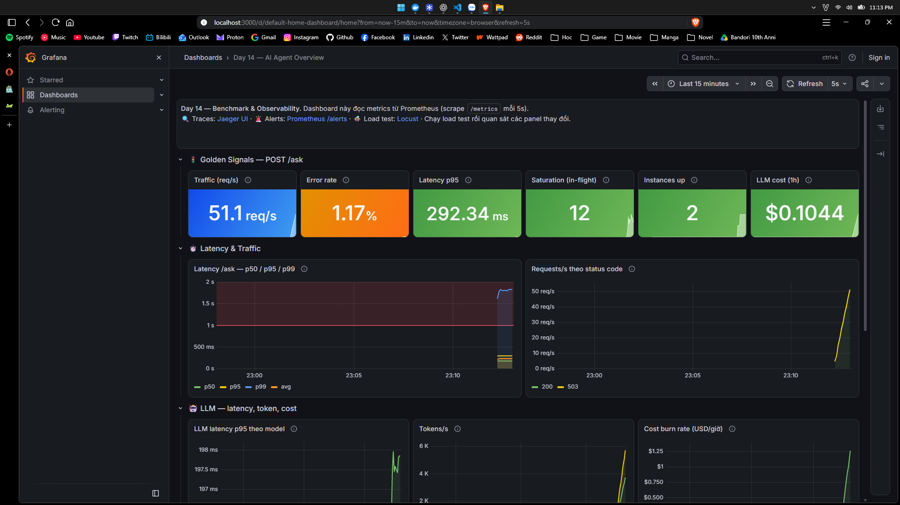
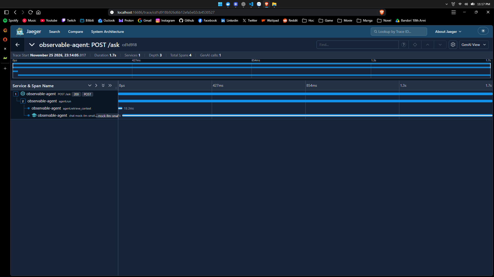
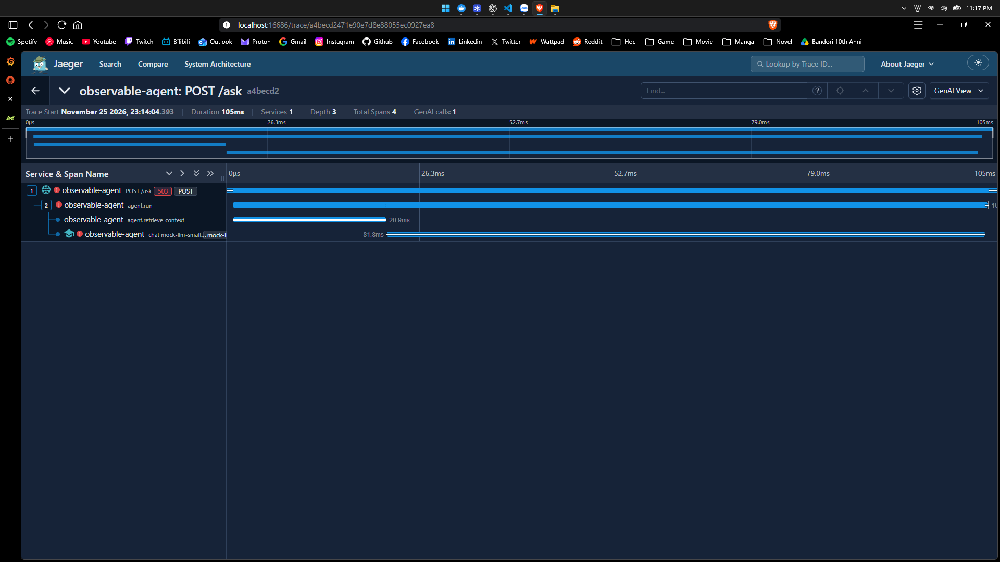
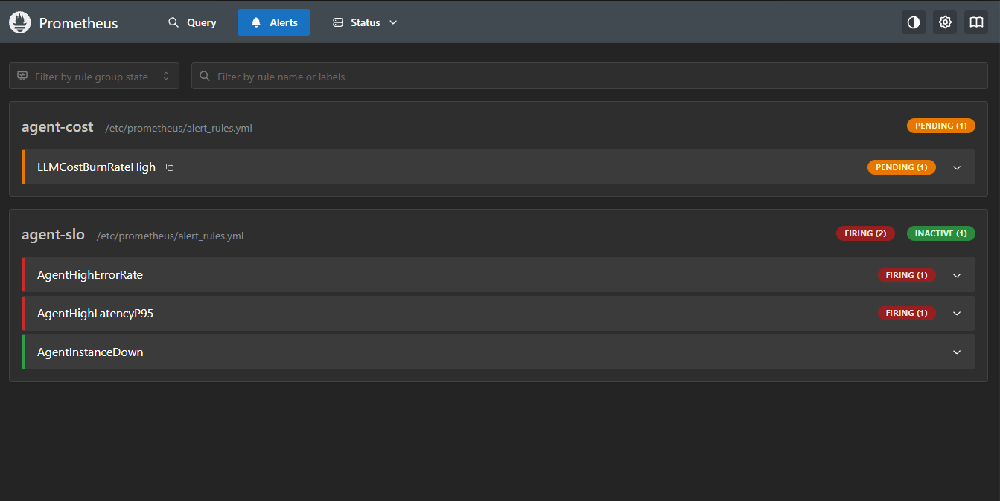

# Benchmark & Observability Report — Day 14

**Họ tên:** Bùi Nguyên Dũng — 2A202603587
**Ngày chạy:** 25/11/2026
**Môi trường:** Lenovo LOQ, Windows, WSL Ubuntu, Python 3.11.18, Docker Desktop.

---

## 1. SLO của agent

| SLI | SLO | Lý do chọn ngưỡng này |
|---|---|---|
| p95 latency `/ask` | < 500 ms | Đảm bảo phần lớn request có thời gian phản hồi nhanh. |
| Error rate `/ask` | < 2% | Hạn chế request thất bại. |
| Accuracy trên golden dataset | ≥ 80% | Đảm bảo chất lượng tối thiểu trước khi triển khai. |

Quality gate sau khi sửa Knowledge Base được nâng lên 100%.

---

## 2. Benchmark hiệu năng (develop, `load_test.py`)

### 2.1 Concurrency vs latency (agent v2)

| Concurrency | RPS | p50 (ms) | p95 (ms) | p99 (ms) | Error rate | SLO |
|---|---:|---:|---:|---:|---:|---|
| 1 | 4.14 | 195.2 | 223.5 | 1714.0 | 0.67% | PASS |
| 10 | 38.37 | 199.2 | 270.9 | 1709.9 | 0.33% | PASS |
| 50 | 93.90 | 287.2 | 366.5 | 1750.5 | 1.00% | PASS |
| 100 | 86.84 | 357.5 | 2257.1 | 2621.7 | 1.00% | FAIL |

**Nhận xét:** RPS không tăng tuyến tính theo concurrency. Khi tăng concurrency từ 1 lên 50, throughput tăng từ 4.14 lên 93.90 RPS. Tuy nhiên, tại concurrency 100, throughput giảm xuống 86.84 RPS và p95 tăng lên 2257.1 ms, vượt SLO.

Kết quả cho thấy dấu hiệu bão hòa khi số lượng request đồng thời tăng cao. Concurrency 50 đạt throughput cao nhất trong các cấu hình đã thử mà vẫn đáp ứng SLO.

Nguồn: `reports/load_v2_c*.json`.

### 2.2 Tail latency

| `MOCK_SLOW_RATE` | avg (ms) | p95 (ms) | p99 (ms) |
|---|---:|---:|---:|
| 0 | 204.9 | 263.8 | 322.0 |
| 0.03 (mặc định) | 252.2 | 258.2 | 1705.3 |
| 0.1 | 361.0 | 1695.1 | 1738.1 |

**Nhận xét:** p99 nhạy với các request chậm hiếm gặp. Khi tỷ lệ request chậm tăng từ 0 lên 3%, p99 tăng từ 322.0 ms lên 1705.3 ms.

Khi tỷ lệ request chậm tăng lên 10%, p95 đạt 1695.1 ms và không còn đáp ứng SLO.

Average latency có thể che giấu các request chậm. Tại tỷ lệ 10%, average chỉ là 361.0 ms nhưng p95 đã vượt 500 ms. Vì vậy, nên sử dụng percentile thay vì chỉ dựa trên average.

Nguồn: `reports/load_v2_slow_*.json`.

---

## 3. Benchmark chất lượng (develop, `eval/run_eval.py`)

| Chỉ số | Agent v1 | Agent v2 | Agent v2 (sau khi sửa KB) |
|---|---:|---:|---:|
| Accuracy | 4.35% | 91.30% | 100% |
| Số câu đúng | 1/23 | 21/23 | 23/23 |
| Avg tokens / câu | 57.1 | 108.7 | 114.1 |
| Tổng cost (USD) | 0.000404 | 0.000756 | 0.000794 |
| Cost / câu đúng (USD) | 0.00040395 | 0.00003599 | 0.00003453 |
| Quality gate | FAIL | PASS | PASS |

**Những câu v2 trả lời sai ban đầu và cách sửa:**

| ID | Keyword bị thiếu | Đã sửa gì |
|---|---|---|
| security-02 | token, hết hạn, chữ ký | Bổ sung kiến thức phân biệt JWT và API key. |
| scaling-03 | cpu, memory, custom metrics | Bổ sung kiến thức về Kubernetes HPA và các chỉ số autoscaling. |

Thực hiện bổ sung hai mục kiến thức vào `develop/utils/mock_llm.py`, sau đó khởi động lại agent v2 và chạy evaluation với ngưỡng accuracy 100%.

Kết quả cuối cùng: 23/23 câu đúng, không có regression, Quality Gate PASS.

**Nhận xét về trade-off chất lượng / chi phí / latency giữa v1 và v2:**

Agent v2 sử dụng retrieval nên số lượng token và tổng chi phí cao hơn v1. p95 latency tăng từ 195.8 ms lên 234.1 ms, nhưng accuracy tăng từ 4.35% lên 91.30%.

Sau khi sửa Knowledge Base, accuracy đạt 100%, p95 đạt 229.3 ms và chi phí trên mỗi câu đúng giảm xuống 0.00003453 USD.

Do đó, cost per correct answer phản ánh hiệu quả tốt hơn cost per answer.

Kết quả 100% chỉ được xác nhận trên golden dataset của lab, chưa chứng minh khả năng tổng quát hóa trên dữ liệu mới.

**CI Quality Gate:** Script evaluation trả exit code 1 nếu accuracy thấp hơn ngưỡng hoặc có regression. Có thể sử dụng exit code này trong CI để ngăn merge khi chất lượng không đạt yêu cầu.

Nguồn:

- `reports/eval_v1.json`
- `reports/eval_v2.json`
- `reports/eval_v2_fixed.json`

---

## 4. Observability stack (production)

Triển khai hệ thống observability bằng Docker Compose gồm Agent, Nginx, Prometheus, Grafana, Jaeger và Locust.

Trong quá trình triển khai, agent gặp lỗi `ModuleNotFoundError: No module named 'uvicorn'`, khiến Nginx trả HTTP 502 và Prometheus không thu thập được metrics.

Đã điều chỉnh Dockerfile để cài dependencies bằng multi-stage build và khởi chạy Uvicorn thông qua `python -m uvicorn`. Sau khi tạo lại container, Prometheus ghi nhận 2/2 agent instances UP và Grafana hiển thị metrics.

### 4.1 Screenshot

- [x] Dashboard Grafana khi đang có tải.
- [x] Trace chậm trong Jaeger.
- [x] Trace lỗi HTTP 503 trong Jaeger.
- [x] Prometheus có hai alert đồng thời FIRING.

**Grafana Dashboard:**

Tại thời điểm chụp:

| Metric | Giá trị |
|---|---:|
| Traffic | 51.1 req/s |
| Error rate | 1.17% |
| Latency p95 | 292.34 ms |
| Saturation (in-flight) | 12 |
| Instances up | 2 |
| LLM cost (1h) | $0.1044 |

**Jaeger slow trace:**

**Jaeger error trace:**

Trace lỗi ghi nhận HTTP 503, với lỗi xuất hiện trong quá trình gọi mock LLM.

**Prometheus Alerts:**

Hai cảnh báo đồng thời FIRING:

- `AgentHighErrorRate`
- `AgentHighLatencyP95`

Cảnh báo `LLMCostBurnRateHigh` ở trạng thái PENDING tại thời điểm chụp.

### 4.2 Thí nghiệm "phá hệ thống"

| # | Thay đổi | Alert nào firing | Thời gian từ lúc đổi → firing | Panel nào phản ánh rõ nhất |
|---|---|---|---|---|
| A | `MOCK_ERROR_RATE=0.2` | AgentHighErrorRate | Chưa đo chính xác; rule yêu cầu duy trì 1 phút | Error rate |
| B | `MOCK_SLOW_RATE=0.3` | AgentHighLatencyP95 | Chưa đo chính xác; rule yêu cầu duy trì 2 phút | Latency p95 |
| C | `LLM_MODEL=mock-llm-large` | Chưa thực hiện | N/A | LLM cost, Cost burn rate (dự kiến) |
| D | `docker pause` 1 instance | Chưa thực hiện | N/A | Instances up (dự kiến) |
| E | `AGENT_VERSION=v1` | Chưa thực hiện | N/A | Quality evaluation (dự kiến) |

Thí nghiệm A và B được thực hiện kết hợp. Prometheus ghi nhận cả hai cảnh báo FIRING đồng thời.

Thời gian cấu hình `for` của alert rule không phải thời gian thực tế đo từ lúc thay đổi cấu hình đến lúc cảnh báo FIRING.

**Thí nghiệm E không làm alert nào firing. Bạn sẽ phát hiện loại sự cố này trong production bằng cách nào?**

Agent có thể trả lời sai nhưng vẫn trả HTTP 200, latency thấp và không phát sinh lỗi hệ thống.

Cần triển khai evaluation định kỳ trên golden dataset, theo dõi accuracy, tỷ lệ câu trả lời đúng, regression giữa các phiên bản và phản hồi của người dùng.

### 4.3 Debug bằng trace

Trace chậm đã quan sát:

- `trace_id`: `cd1d918b926d6b12efa5e02cb4530527`
- Tổng thời gian hiển thị: 1.7 giây.
- HTTP status: 200.
- Tổng số spans: 4.
- Span `agent.retrieve_context`: 18.2 ms.
- Span gọi `mock-llm-small` chiếm phần lớn thời gian xử lý.
- Thời gian chính xác và tỷ lệ phần trăm của span LLM: chưa trích xuất.
- Dòng JSON log tương ứng: chưa lưu được.

Kết quả trace cho thấy thời gian xử lý chậm chủ yếu nằm ở bước gọi mock LLM, không phải retrieval.

Trace lỗi đã quan sát có tổng thời gian 105 ms và HTTP status 503.

---

## 5. Benchmark scaling (production, Locust headless, 100 users, 2 phút)

| Số instance | RPS | p50 (ms) | p95 (ms) | p99 (ms) | Failures |
|---|---:|---:|---:|---:|---:|
| 1 | 66.20 | 190 | 220 | 1700 | 79 |
| 3 | 65.81 | 190 | 220 | 1700 | 89 |

Số liệu lấy từ dòng `Aggregated` trong hai file CSV.

| Chỉ số bổ sung | Scale 1 | Scale 3 |
|---|---:|---:|
| Tổng requests | 7913 | 7876 |
| Error rate tổng | 1.00% | 1.13% |
| RPS riêng `/ask` | 60.15 | 59.73 |
| Average latency (ms) | 210.44 | 213.95 |

**Giải thích kết quả:**

Tăng số instance từ 1 lên 3 không cải thiện p95 trong lượt benchmark này. Cả hai lượt đều có p95 bằng 220 ms và p99 bằng 1700 ms.

Throughput gần như không thay đổi. Điều này cho thấy tăng số instance không nhất thiết cải thiện hiệu năng nếu workload chưa bão hòa năng lực xử lý hoặc latency chủ yếu đến từ thời gian chờ mock LLM.

Cần kiểm tra thêm CPU, memory, phân phối request giữa các instance và chạy benchmark lặp lại để xác định chính xác nút thắt.

Nguồn:

- `benchmark-results/scale_1_stats.csv`
- `benchmark-results/scale_3_stats.csv`

---

## 6. Kết luận

**Ba điều học được về benchmark và observability:**

1. Throughput không tăng tuyến tính theo concurrency. Cần theo dõi p95 và p99 để phát hiện bão hòa và tail latency.
2. Chất lượng agent phải được đánh giá cùng với latency và chi phí. Cost per correct answer có ý nghĩa hơn chỉ số chi phí trên mỗi request.
3. Metrics, logs và traces bổ sung cho nhau. Prometheus và Grafana giúp phát hiện sự cố, Jaeger giúp xác định bước xử lý gây chậm hoặc lỗi.

**Nếu đưa agent lên production thật, sẽ bổ sung:**

- Accuracy và quality regression alert.
- Token usage và cost per correct answer.
- CPU, memory và queue length.
- Tỷ lệ timeout và lỗi upstream LLM.
- Cảnh báo vượt ngân sách.
- Theo dõi SLO và error budget.

**Giới hạn:** Lab sử dụng mock LLM nên chi phí và latency không đại diện hoàn toàn cho hệ thống thực tế. Thí nghiệm C, D, E và việc đối chiếu JSON log với trace ID chưa hoàn thành.

**AI Usage Log:** Sử dụng ChatGPT để hỗ trợ phân tích benchmark, sửa Knowledge Base, xử lý lỗi Dockerfile, hướng dẫn sử dụng Grafana/Prometheus/Jaeger và tổng hợp báo cáo. Các số liệu được lấy từ kết quả chạy thực tế, không sử dụng số liệu do AI tự tạo.