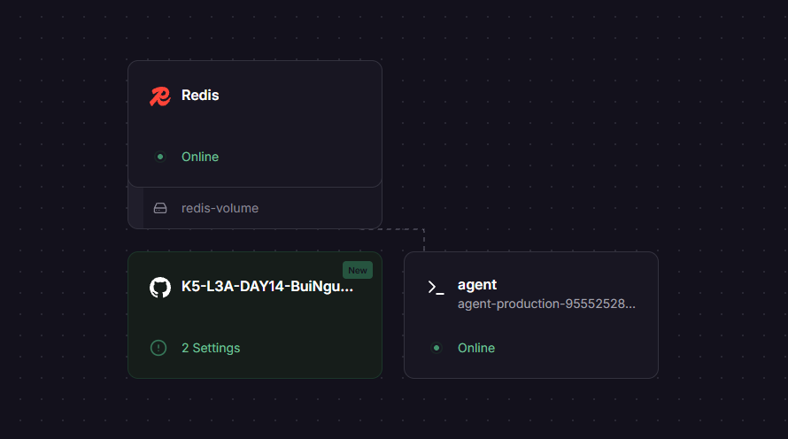
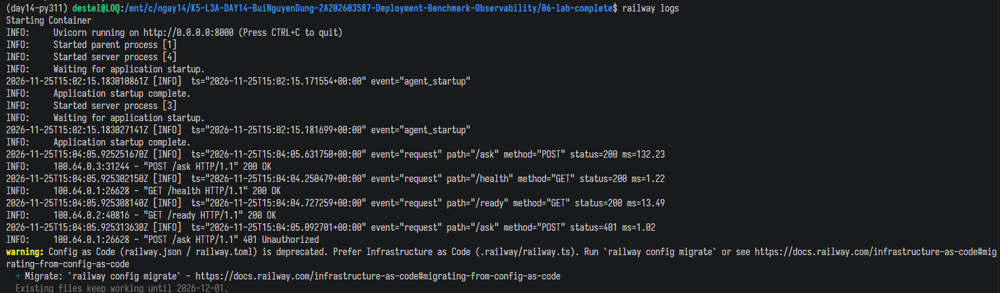
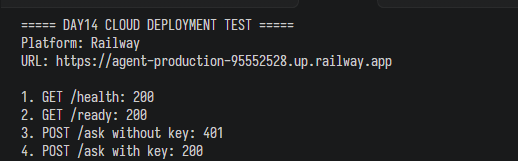

# DAY 14 — CLOUD DEPLOYMENT

## 1. Thông tin triển khai

| Hạng mục | Thông tin |
|---|---|
| Cloud Platform | Railway |
| Project | miraculous-intuition |
| Environment | production |
| Service | agent |
| Source Directory | `06-lab-complete/` |
| Deployment Method | Railway CLI 5.75.0 |
| Build Method | Multi-stage Dockerfile |
| Configuration | `railway.toml` |
| Python | 3.11 |
| Web Server | Uvicorn |
| Workers | 2 |
| Port | 8000 |
| Database | Redis |
| LLM | Mock LLM |
| Deployment Status | Online |

**Public URL:** https://agent-production-95552528.up.railway.app

## 2. Kiến trúc triển khai

```text
Client
   |
   | HTTPS
   v
Railway Public Domain
   |
   v
Production AI Agent
(FastAPI + Uvicorn, 2 workers)
   |
   +-- API Key Authentication
   +-- Rate Limiting
   +-- Cost Guard
   +-- Mock LLM
   |
   v
Redis Service
   |
   v
Persistent Volume
```

Agent và Redis được triển khai trong cùng một Railway project. Redis lưu trạng thái Rate Limiting và Cost Guard, giúp các worker sử dụng chung dữ liệu.

## 3. Environment Variables

| Variable | Value | Purpose |
|---|---|---|
| `AGENT_API_KEY` | Hidden | Xác thực API |
| `REDIS_URL` | Railway Redis Service reference | Kết nối Redis |
| `ENVIRONMENT` | production | Môi trường triển khai |
| `RATE_LIMIT_PER_MINUTE` | 10 | Giới hạn request mỗi phút |
| `DAILY_BUDGET_USD` | 1.0 | Giới hạn ngân sách mỗi ngày |
| `PORT` | 8000 | Cổng ứng dụng |

API key và thông tin xác thực Redis được cấu hình thông qua Railway Variables, không công khai trong báo cáo.

## 4. Deployment Process

1. Cài đặt Railway CLI trên WSL Ubuntu.
2. Đăng nhập và liên kết Railway project.
3. Tạo Redis Service.
4. Tạo Agent Service.
5. Cấu hình environment variables.
6. Triển khai ứng dụng từ `06-lab-complete/` bằng Dockerfile.
7. Tạo Public Domain.
8. Kiểm thử Health Check, Readiness và API Authentication.

## 5. Test Commands

```bash
BASE="https://agent-production-95552528.up.railway.app"

read -rsp "API Key: " AGENT_API_KEY
echo

# Health Check
curl -sS -o /dev/null -w '%{http_code}\n' \
    "$BASE/health"

# Readiness Check
curl -sS -o /dev/null -w '%{http_code}\n' \
    "$BASE/ready"

# Request without API Key
curl -sS -o /dev/null -w '%{http_code}\n' \
    -X POST "$BASE/ask" \
    -H 'Content-Type: application/json' \
    -d '{"question":"Hello"}'

# Request with API Key
curl -sS -o /dev/null -w '%{http_code}\n' \
    -X POST "$BASE/ask" \
    -H 'Content-Type: application/json' \
    -H "X-API-Key: $AGENT_API_KEY" \
    -d '{"question":"Hello"}'
```

## 6. Kết quả kiểm thử thực tế

| Test | Expected | Actual | Result |
|---|---:|---:|---|
| GET /health | 200 | 200 | PASS |
| GET /ready | 200 | 200 | PASS |
| POST /ask without API key | 401 | 401 | PASS |
| POST /ask with API key | 200 | 200 | PASS |

Terminal output:

```text
===== DAY14 CLOUD DEPLOYMENT TEST =====
Platform: Railway
URL: https://agent-production-95552528.up.railway.app

1. GET /health: 200
2. GET /ready: 200
3. POST /ask without key: 401
4. POST /ask with key: 200
```

**Cloud Deployment: PASS 4/4.**

Kết quả cho thấy:

- Agent hoạt động thông qua Public HTTPS URL.
- Health Check hoạt động bình thường.
- Agent kết nối Redis thành công.
- Request không có API key bị từ chối.
- Request có API key hợp lệ được xử lý thành công.

## 7. Production Readiness

Kết quả kiểm thử Production Readiness tại local trước khi triển khai:

| Metric | Result |
|---|---|
| Production Readiness | 12/12 PASS |
| Total Checks | 43/43 PASS |
| Docker Image Size | 238 MB |
| API Authentication | PASS |
| Redis Rate Limiting | PASS |
| Cost Guard | PASS |
| Structured Logging | PASS |
| Graceful Shutdown | PASS |

Sau khi triển khai Railway:

- Agent Service: Online.
- Redis Service: Online.
- Uvicorn: 2 workers.
- Application Startup: Complete.
- Public API Testing: 4/4 PASS.

## 8. Troubleshooting

| Vấn đề | Cách xử lý | Kết quả |
|---|---|---|
| GitHub integration không tải được branch | Chuyển sang Railway CLI | Thành công |
| Railway CLI xung đột PATH giữa Windows và WSL | Cài Railway CLI dành cho Linux và cập nhật PATH | Thành công |
| Docker BuildKit báo lỗi exclude-patterns | Chuẩn hóa `.dockerignore` | Chưa giải quyết được lỗi |
| Docker build trên Railway tiếp tục thất bại | Tạo build context sạch, chỉ chứa các file cần thiết | Thành công |

Build context cuối cùng:

```text
deploy-context/
├── .dockerignore
├── Dockerfile
├── railway.toml
├── requirements.txt
├── app/
└── utils/
```

Sau khi sử dụng build context sạch, Railway build Docker image và khởi động container thành công mà không cần thay đổi logic của Agent.

Nguyên nhân gốc chính xác của lỗi BuildKit chưa được xác định.

## 9. Screenshots

### 9.1. Railway Dashboard

Agent và Redis đều ở trạng thái Online.



### 9.2. Running Deployment

Container khởi động thành công, Uvicorn chạy trên port 8000 với hai workers và ghi nhận request logs.



### 9.3. Public API Testing

Bốn bài kiểm thử HTTP đều đạt kết quả mong muốn.



## 10. Limitations

- Sử dụng Mock LLM, chưa tích hợp LLM thực tế.
- Cost Guard sử dụng chi phí token ước tính.
- Public URL phụ thuộc hạn mức và thời gian hoạt động của Railway.
- Railway CLI cảnh báo cấu hình `railway.toml` sẽ hết thời gian hỗ trợ từ ngày 01/12/2026.
- Chưa thực hiện load testing trên cloud; benchmark được thực hiện riêng trong Part 7.

## 11. Conclusion

Production AI Agent đã được triển khai thành công trên Railway với Redis, API Key Authentication, Rate Limiting, Cost Guard và Structured Logging.

Kết quả Production Readiness tại local đạt 12/12, tương ứng 43/43 checks. Kết quả kiểm thử Public API trên Railway đạt 4/4.

**CP6 — Cloud Deployment: PASS.**