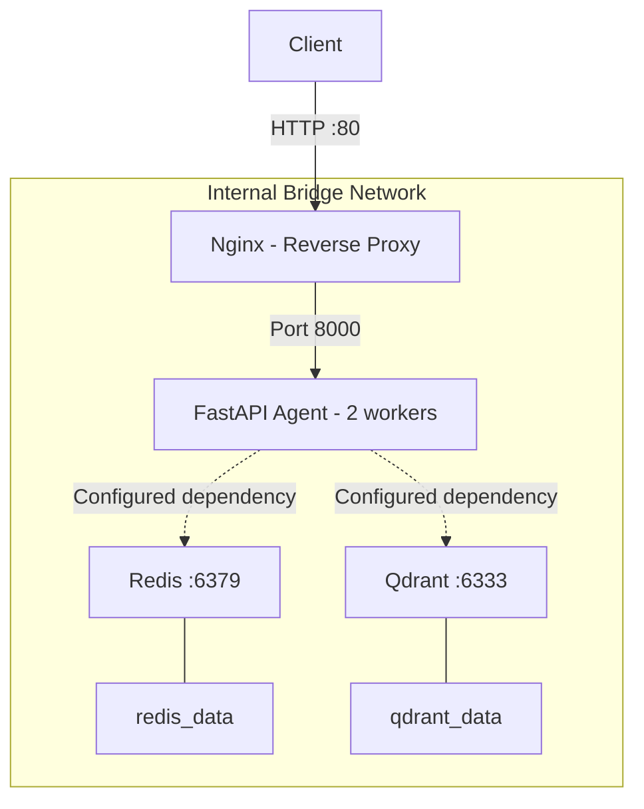
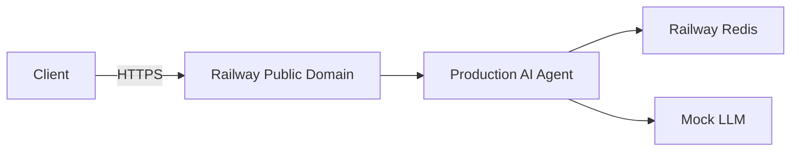
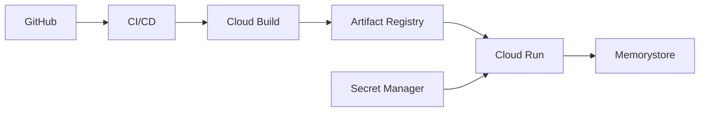
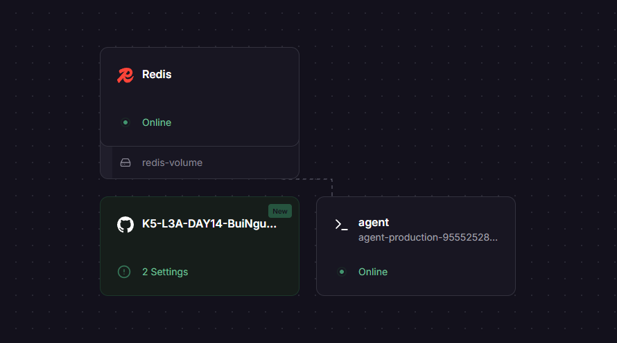
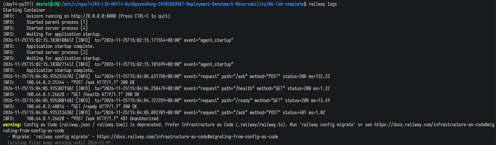
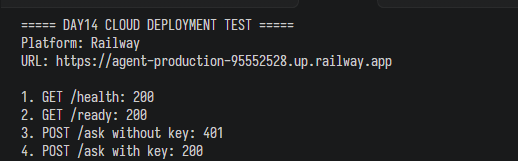
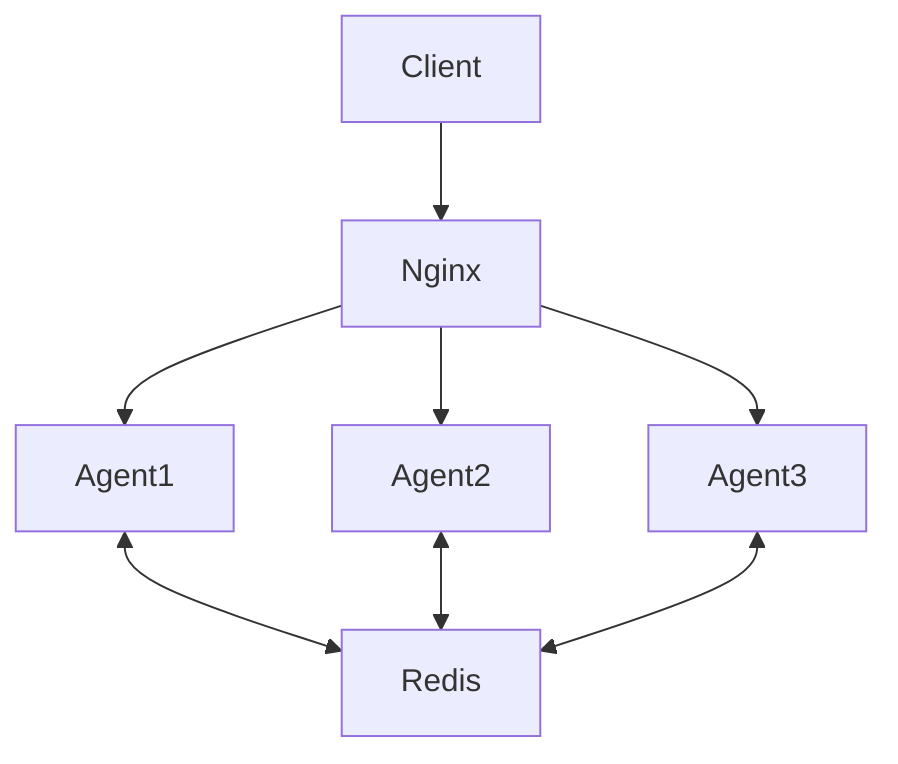
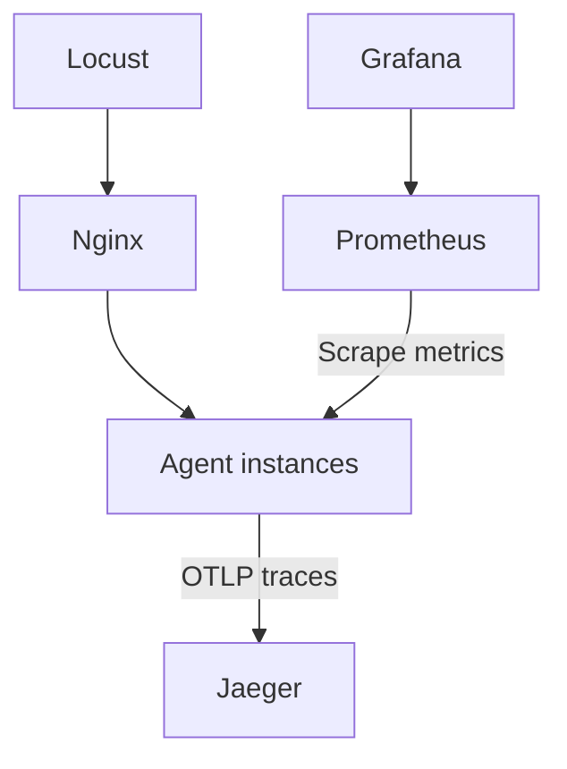

# MISSION ANSWERS — DAY 14

## Part 1 — Localhost vs Production (CP1)

### Exercise 1.1 — Anti-patterns

Các vấn đề phát hiện trong `develop/app.py`:

1. API key được hardcode trong source code.
2. Database URL chứa thông tin đăng nhập trực tiếp.
3. Không quản lý cấu hình bằng environment variables.
4. Sử dụng `print()` thay cho structured logging.
5. Ghi API key vào log.
6. Không có health check và readiness check.
7. Port cố định tại 8000.
8. Chỉ bind vào localhost.
9. Luôn bật reload.
10. Không có lifecycle cleanup riêng.

### Exercise 1.2 — Basic version

Chạy thành công trên Ubuntu WSL2 với mock LLM.

| Endpoint | HTTP status |
|---|---|
| GET / | 200 |
| POST /ask?question=Hello | 200 |
| GET /health | 404 |
| GET /ready | 404 |

**Nhận xét:** Agent hoạt động trên localhost nhưng chưa phù hợp để triển khai production do thiếu cơ chế giám sát, quản lý cấu hình và bảo mật secret.

### Exercise 1.3 — Advanced version

| Feature | Basic | Advanced | Tại sao quan trọng? |
|---|---|---|---|
| Config | Hardcode | Environment variables | Linh hoạt khi triển khai, tránh lộ secret |
| Health check | Không có | /health, /ready | Giám sát trạng thái và điều phối traffic |
| Logging | print() | Structured JSON logging | Hỗ trợ giám sát và phân tích lỗi |
| Shutdown | Không có cleanup riêng | Graceful shutdown qua lifespan | Dừng ứng dụng an toàn |
| Host | localhost | 0.0.0.0 | Hỗ trợ truy cập từ bên ngoài container |
| Port | Cố định | Đọc từ config | Tương thích cloud platform |
| Reload | Luôn bật | Theo cấu hình debug | Giảm overhead khi chạy production |

**Kết quả kiểm thử thực tế:**

| Endpoint | HTTP status |
|---|---|
| GET / | 200 |
| GET /health | 200 |
| GET /ready | 200 |
| POST /ask | 200 |
| GET /metrics | 200 |
| POST /ask với JSON rỗng | 422 |

- API tests: 6/6 PASS.
- Agent version: 1.0.0.
- Uptime tại thời điểm kiểm tra health: 29.6 giây.
- Readiness: true.
- LLM: Mock LLM.
- Environment: development.

**Graceful shutdown:** Uvicorn ghi nhận Application shutdown complete và Finished server process. Tuy nhiên, sau khi nhấn Ctrl+C vẫn xuất hiện traceback CancelledError và KeyboardInterrupt trên Python 3.14.4. Chưa xác định nguyên nhân chính xác.

**Kết luận:** Advanced version cải thiện khả năng cấu hình, giám sát và quản lý vòng đời ứng dụng so với Basic version.

### AI Usage Log — CP1

- Công cụ: ChatGPT.
- Mục đích: Hỗ trợ phân tích anti-patterns, giải thích code, cung cấp lệnh kiểm thử và tổng hợp kết quả.
- Kiểm chứng: Trực tiếp chạy kiểm thử trên Ubuntu WSL2, đối chiếu HTTP status và log thực tế.

---

## Part 2 — Docker Containerization (CP2)

### Exercise 2.1 — Dockerfile cơ bản

1. Base image: `python:3.11`.
2. Working directory: `/app`.
3. COPY `requirements.txt` trước để tận dụng Docker layer caching, tránh cài lại dependencies khi chỉ thay đổi source code.
4. CMD cung cấp lệnh hoặc đối số mặc định khi container khởi động. ENTRYPOINT xác định chương trình chính của container.

### Exercise 2.2 — Build và chạy Develop Image

- Image: `agent-develop:latest`.
- Build time: 37.1 giây.
- Image size: 1667.78 MB.
- GET /health: HTTP 200.
- POST /ask: HTTP 200.
- Health status: ok.
- Container: true.
- Uptime khi kiểm thử: 12.7 giây.

Kết quả: PASS.

### Exercise 2.3 — Multi-stage Build

Dockerfile production sử dụng hai stage:

- Builder: cài dependencies và build tools trên `python:3.11-slim`.
- Runtime: chỉ copy dependencies và source code cần thiết, sử dụng non-root user và healthcheck.

| Tiêu chí | Develop | Production |
|---|---|---|
| Base image | python:3.11 | python:3.11-slim |
| Build stages | 1 | 2 |
| User | root | appuser |
| Docker Healthcheck | Không | Có |
| Image size | 1667.78 MB | 239.82 MB |
| Image size (bytes) | 1667780015 | 239815252 |

- Dung lượng giảm: 1427.96 MB.
- Tỷ lệ giảm: 85.62%.
- Mục tiêu production image dưới 500 MB: ĐẠT.

**Kiểm thử production container:**

- GET /health: HTTP 200.
- Container user: appuser.
- Healthcheck: healthy.
- Uvicorn: 2 workers.
- Structured logging: hoạt động.
- Agent version: 2.0.0.

Kết quả: PASS.

### Exercise 2.4 — Docker Compose

**Sơ đồ kiến trúc:**



**Kết quả khởi động:**

| Service | Status |
|---|---|
| Agent | Healthy |
| Redis | Healthy |
| Qdrant | Healthy |
| Nginx | Running |

**Kiểm thử API qua Nginx:**

| Endpoint | HTTP status |
|---|---|
| GET / | 200 |
| GET /health | 200 |
| GET /ready | 200 |
| POST /ask | 200 |
| POST /ask với JSON rỗng | 422 |

- API tests: 5/5 PASS.
- Environment: staging.
- Redis: PONG.
- Qdrant TCP connectivity: OK.
- Reverse proxy: Server nginx.
- Security headers trên response 200: X-Frame-Options, X-Content-Type-Options, X-XSS-Protection.

**Rate Limiting:**

- Cấu hình: 10 requests/giây/IP, burst 20.
- Tổng request: 100.
- Concurrency tối đa: 30.
- HTTP 200: 21.
- HTTP 429: 79.
- HTTP 5xx: 0.
- Các service vẫn hoạt động sau kiểm thử.

Kết quả: PASS.

**Hạn chế của cấu hình mẫu:**

- Một Agent container chạy hai workers, chưa triển khai hai replicas.
- Redis và Qdrant đã khởi động nhưng chưa được tích hợp vào logic xử lý request.
- Port 443 được khai báo nhưng chưa cấu hình TLS.
- Security headers chưa áp dụng cho mọi HTTP status.
- Docker Compose cảnh báo thuộc tính version đã lỗi thời.

**Cleanup:** Docker Compose down thành công, xóa bốn container và một network. Không xóa persistent volumes.

**Kết luận:** CP2 hoàn thành. Multi-stage build kết hợp slim base image giảm 85.62% kích thước image. Docker Compose khởi động thành công bốn service, reverse proxy và rate limiting hoạt động đúng trong kiểm thử local.

### AI Usage Log — CP2

- Công cụ: ChatGPT.
- Mục đích: Hỗ trợ phân tích Dockerfile, giải thích multi-stage build, Docker Compose và rate limiting.
- AI hỗ trợ xử lý lỗi HTTP 429 khi tải base image từ Docker Hub.
- Kiểm chứng: Trực tiếp thực hiện build, chạy container, kiểm thử API và thu thập số liệu thực tế.

---

## Part 3 — Cloud Deployment (CP6)

### Exercise 3.1 — Railway Deployment

Triển khai Production AI Agent từ thư mục `06-lab-complete/` lên Railway bằng Railway CLI.

**Thông tin triển khai:**

- Platform: Railway.
- Environment: production.
- Services: Agent và Redis.
- Deployment: Dockerfile.
- LLM: Mock LLM.
- Public URL: https://agent-production-95552528.up.railway.app

**Environment variables:**

| Variable | Giá trị hoặc mô tả |
|---|---|
| ENVIRONMENT | production |
| AGENT_API_KEY | Secret được cấu hình trên Railway |
| REDIS_URL | Tham chiếu Railway Redis service |
| PORT | 8000 |
| RATE_LIMIT_PER_MINUTE | 10 |
| DAILY_BUDGET_USD | 1.0 |

Không đưa giá trị API Key hoặc Redis credentials vào source code và báo cáo.

**Kiến trúc triển khai:**



**Quá trình triển khai:**

1. Cài đặt Railway CLI trên WSL Ubuntu.
2. Đăng nhập và liên kết Railway project.
3. Tạo Redis service và Agent service.
4. Cấu hình environment variables.
5. Build và deploy Agent.
6. Tạo public domain.
7. Kiểm thử API thông qua public URL.

Trong quá trình deploy, Docker build context gặp lỗi liên quan đến `exclude-patterns` chứa ký tự không hợp lệ. Đã thử điều chỉnh `.dockerignore` và sử dụng thư mục build context riêng chỉ chứa các file cần thiết.

Sau khi sử dụng build context riêng, Railway build và deploy thành công. Chưa xác định chính xác nguyên nhân gốc của lỗi build context.

**Kết quả kiểm thử thực tế:**

| Kiểm thử | HTTP status | Kết quả |
|---|---|---|
| GET /health | 200 | PASS |
| GET /ready | 200 | PASS |
| POST /ask không có API Key | 401 | PASS |
| POST /ask có API Key hợp lệ | 200 | PASS |

Kết quả: 4/4 PASS.

Agent hoạt động trên public URL và kết nối Redis thành công tại thời điểm kiểm thử.

### Exercise 3.2 — So sánh Railway và Render

| Tiêu chí | Railway | Render |
|---|---|---|
| Config file | railway.toml | render.yaml |
| Build | Dockerfile | Dockerfile |
| Health check | /health | /health |
| Environment variables | Railway Variables | Render Environment Variables |
| Redis | Railway Redis | Redis-compatible service |
| Public domain | Railway Domain | Render Domain |
| Kết quả | Đã triển khai | Chỉ chuẩn bị cấu hình |

Railway được lựa chọn để triển khai thực tế trong lab. Render là phương án thay thế, chưa thực hiện deployment.

### Exercise 3.3 — Google Cloud Run

Pipeline triển khai đề xuất:



- Cloud Build: build và kiểm thử Docker image.
- Artifact Registry: lưu trữ Docker image.
- Cloud Run: triển khai container và tự động scaling.
- Secret Manager: quản lý API Key và các thông tin nhạy cảm.
- Memorystore: lưu trạng thái dùng chung giữa các instances.

Đây là phương án triển khai đề xuất, chưa triển khai thực tế trên Google Cloud Run.

### Bằng chứng triển khai

- `DEPLOYMENT.md`
- `screenshots/dashboard.png`
- `screenshots/running.png`
- `screenshots/test.png`







### AI Usage Log — CP6

- Công cụ: ChatGPT.
- Mục đích: Hỗ trợ cấu hình Railway CLI, Redis, environment variables và xử lý lỗi Docker build context.
- Kiểm chứng: Trực tiếp triển khai và kiểm thử Public URL.
- Kết quả: Agent và Redis hoạt động trên Railway, 4/4 HTTP tests PASS.

---

## Part 4 — API Gateway & Security (CP3)

### 4.1. Basic — API Key Authentication

Chạy ứng dụng Basic và kiểm thử xác thực thông qua header `X-API-Key`.

| Trường hợp | HTTP status | Kết quả |
|---|---|---|
| API Key hợp lệ | 200 | PASS |
| Không có API Key | 401 | PASS |
| API Key không hợp lệ | 403 | PASS |

### 4.2. Advanced — JWT Authentication

Cấu hình:

- JWT Algorithm: HS256.
- Token expiration: 60 phút.
- Student: role user, 10 request/phút.
- Teacher: role admin, 100 request/phút.

| Trường hợp | Kết quả thực tế |
|---|---|
| Health Check | 200 |
| Đăng nhập sai mật khẩu | 401 |
| Đăng nhập đúng | Nhận JWT dài 168 ký tự |
| JWT hợp lệ | 200 |
| Thiếu JWT | 401 |
| JWT không hợp lệ | 403 |
| Student truy cập /admin/stats | 403 |
| Teacher truy cập /admin/stats | 200 |

Kết quả: PASS 8/8.

### 4.3. Rate Limiting

Sử dụng Sliding Window với giới hạn 10 request/60 giây đối với Student.

Gửi liên tiếp 20 request:

| Chỉ số | Kết quả |
|---|---:|
| Tổng request | 20 |
| HTTP 200 | 10 |
| HTTP 429 | 10 |
| Tỷ lệ request bị chặn | 50% |

Request 1–10 được xử lý thành công, request 11–20 bị chặn. Rate Limiter hoạt động đúng với cấu hình.

### 4.4. Input Validation

Pydantic kiểm tra trường `question` với độ dài từ 1 đến 1000 ký tự.

| Trường hợp | HTTP status | Kết quả |
|---|---|---|
| Thiếu question | 422 | PASS |
| Question rỗng | 422 | PASS |
| Question dài 1001 ký tự | 422 | PASS |
| Question hợp lệ | 200 | PASS |

### 4.5. Cost Guard

Cấu hình ngân sách:

- Per-user daily budget: $1.
- Global daily budget: $10.
- Warning threshold: 80%.

Kiểm thử độc lập class `CostGuard` bằng dữ liệu token giả lập:

| Test case | Kết quả thực tế |
|---|---|
| Normal Budget | Request allowed |
| Usage Tracking | $0.00075 |
| Budget Warning | WARNING tại 84% |
| User Budget Exceeded | Exception 402 tại $1.20 |
| Global Budget Exceeded | Exception 503 tại khoảng $14.0407 |

Kết quả: PASS 5/5.

Thống kê thực tế từ endpoint `/me/usage` của Student:

| Metric | Giá trị |
|---|---:|
| Requests | 11 |
| Input tokens | 66 |
| Output tokens | 330 |
| Cost USD | 0.000208 |
| Budget USD | 1.0 |
| Remaining budget USD | 0.999792 |

Toàn bộ token và chi phí được giả lập, không sử dụng LLM API thật.

### 4.6. Security Headers

Các header quan sát được trong HTTP response:

- X-Content-Type-Options: nosniff.
- X-Frame-Options: DENY.
- X-XSS-Protection: 1; mode=block.
- Referrer-Policy: strict-origin-when-cross-origin.

### 4.7. Câu hỏi thảo luận

**1. Khi nào nên dùng API Key vs JWT vs OAuth2?**

- API Key: phù hợp với giao tiếp service-to-service hoặc API đơn giản.
- JWT: phù hợp với hệ thống có đăng nhập, phân quyền và token hết hạn.
- OAuth2: phù hợp khi cần cấp quyền truy cập cho ứng dụng bên thứ ba mà không chia sẻ mật khẩu người dùng.

**2. Rate limit nên đặt bao nhiêu request/phút cho một AI Agent?**

Phụ thuộc vào chi phí model, độ phức tạp của request, tài nguyên hệ thống và nhu cầu người dùng. Có thể bắt đầu với 10 request/phút cho user thông thường và 100 request/phút cho admin như trong lab, sau đó điều chỉnh dựa trên benchmark và ngân sách.

**3. Nếu API Key bị lộ, phát hiện và xử lý như thế nào?**

- Phát hiện thông qua audit log, bất thường về request, chi phí và secret scanning.
- Thu hồi API Key bị lộ ngay lập tức.
- Tạo key mới và cập nhật secret trên hệ thống.
- Kiểm tra lịch sử sử dụng để xác định phạm vi ảnh hưởng.
- Sử dụng Secret Manager, giới hạn quyền và ngân sách để giảm rủi ro.

### 4.8. Hạn chế và đề xuất cải thiện

- JWT secret mặc định và tài khoản demo được hardcode.
- Rate Limiter và Cost Guard sử dụng in-memory, cần Redis hoặc database khi triển khai nhiều instance.
- Header `server: uvicorn` vẫn xuất hiện trong HTTP response.
- Trường `budget_remaining_usd` tại `/ask` trả về chi phí đã sử dụng thay vì ngân sách còn lại.
- Global budget chưa có cơ chế reset theo ngày.
- Cost Guard chưa dự trù chi phí của request tiếp theo trước khi gọi LLM.
- Chưa kiểm thử JWT hết hạn, header Retry-After và HTTP 402/503 end-to-end trong phần này.

### AI Usage Log — CP3

- Công cụ: ChatGPT.
- Mục đích: Hỗ trợ đọc hiểu source code, xây dựng lệnh kiểm thử API Key, JWT, RBAC, Rate Limiting, Input Validation và Cost Guard.
- Kiểm chứng: Trực tiếp chạy ứng dụng và các lệnh kiểm thử trên WSL Ubuntu, đối chiếu HTTP response và terminal log.
- Kết quả: Hoàn thành các kiểm thử chính của Part 4 và xác định một số hạn chế của ứng dụng mẫu.

---

## Part 5 — Scaling & Reliability (CP4)

### 5.1. Health Check & Graceful Shutdown

Chạy ứng dụng Develop trên WSL Ubuntu, sử dụng FastAPI 0.115.0, Uvicorn 0.30.0 và psutil 6.0.0.

| Kiểm thử | Kết quả |
|---|---|
| GET /health | HTTP 200, status: ok |
| GET /ready | HTTP 200, ready: true |
| POST /ask | HTTP 200, mock response |
| Uptime tại Health Check | 273.4 giây |
| Memory usage | 16.0% |
| Server PID | 6489 |

**Graceful Shutdown:**

- Gửi 2 request song song.
- Gửi tín hiệu SIGTERM sau 0.5 giây.
- Request 1: HTTP 200.
- Request 2: HTTP 200.
- Số request hoàn thành: 2/2.
- Số request bị mất trong lần thử: 0.
- Process PID 6489 đã dừng và port 8000 được giải phóng.

Kết quả phù hợp với mục tiêu Graceful Shutdown. Tuy nhiên, chưa thu thập log shutdown và thời gian xử lý từng request để xác nhận cả hai request vẫn đang xử lý tại thời điểm nhận SIGTERM.

### 5.2. Stateless Agent + Redis + Nginx

Khởi chạy hệ thống:

```bash
docker compose up -d --build --scale agent=3
```

Docker build thành công trong 46.9 giây. Hệ thống gồm 3 Agent instances, 1 Redis và 1 Nginx.

**Kiến trúc:**



| Container | Instance ID | Trạng thái |
|---|---|---|
| Agent 1 | instance-dd2dbc | Healthy |
| Agent 2 | instance-dc40c9 | Healthy |
| Agent 3 | instance-5b7193 | Healthy |
| Redis | — | Healthy |
| Nginx | — | Running |

Cả 3 Agent instances đều kết nối Redis thành công. Redis trả về PONG. Hai endpoint `/health` và `/ready` thông qua Nginx đều trả HTTP 200.

### 5.3. Kiểm thử Stateless Session

Chạy:

```bash
python test_stateless.py
```

Session ID: `d150aa81-efda-4b0c-a2a7-7d4c3250087f`

| Request | Instance xử lý |
|---|---|
| 1 | instance-dc40c9 |
| 2 | instance-5b7193 |
| 3 | instance-dd2dbc |
| 4 | instance-dc40c9 |
| 5 | instance-5b7193 |

Kết quả:

- Tổng request thành công: 5/5.
- Số instance tham gia: 3/3.
- Tổng messages: 10/10.
- User messages: 5.
- Assistant messages: 5.
- Không mất lịch sử hội thoại trong bài kiểm thử.

**Kiểm tra trực tiếp Redis:**

| Tiêu chí | Kết quả |
|---|---|
| Session key | Tồn tại |
| DBSIZE | 1 |
| TTL cấu hình | 3600 giây |
| TTL còn lại khi kiểm tra | 3319 giây |
| Total messages | 10 |
| User messages | 5 |
| Assistant messages | 5 |
| Assertion | PASS |

### 5.4. Kiểm thử Load Balancing

Gửi 12 request GET /health thông qua Nginx.

| Instance | Requests | Tỷ lệ |
|---|---:|---:|
| instance-dd2dbc | 4 | 33.33% |
| instance-dc40c9 | 4 | 33.33% |
| instance-5b7193 | 4 | 33.33% |
| Tổng | 12 | 100% |

Nginx phân phối request đồng đều giữa 3 instances trong bài kiểm thử.

### 5.5. So sánh Develop và Production

| Tiêu chí | Develop | Production |
|---|---|---|
| Instances | 1 | 3 |
| State | In-memory | Redis-backed session |
| Load Balancer | Không có | Nginx |
| Scaling | Single instance | Horizontal scaling |
| Session TTL | Không áp dụng | 3600 giây |
| Deployment | Python local | Docker Compose |

### 5.6. Hạn chế và đề xuất cải thiện

- Redis fallback sang in-memory có thể làm mất khả năng chia sẻ session giữa các instances.
- Thao tác đọc–sửa–ghi session chưa đảm bảo atomic khi có request đồng thời.
- Redis chưa được cấu hình persistent volume riêng.
- Trường turn có khả năng bị lệch một đơn vị.
- Mock LLM chưa sử dụng conversation history để tạo câu trả lời.
- Test script gốc chưa có assertion kiểm tra số lượng messages; đã bổ sung kiểm tra trực tiếp bằng Redis CLI và Python.
- Chưa kiểm thử tải lớn, concurrent session updates hoặc khả năng phục hồi khi Redis gặp sự cố trong Part 5.

### 5.7. Kết luận

Hoàn thành triển khai và kiểm thử Health Check, Readiness, Graceful Shutdown, Horizontal Scaling, Load Balancing và Stateless Session.

Ba Agent instances có thể xử lý cùng một phiên hội thoại với lịch sử được lưu tập trung trong Redis. Kết quả kiểm thử xác nhận đầy đủ 10 messages sau 5 requests tuần tự.

Đã chạy `docker compose down`, xóa 5 containers và 1 network. Không còn container của Part 5 đang chạy tại thời điểm cleanup. Không thay đổi source code mẫu.

**CP4: PASS đối với các bài kiểm thử đã thực hiện.**

### AI Usage Log — CP4

- Công cụ: ChatGPT.
- Mục đích: Hỗ trợ đọc source code, giải thích Health Check, Graceful Shutdown, Stateless Design, Redis và Nginx Load Balancing.
- AI hỗ trợ: Đề xuất lệnh triển khai, kiểm thử SIGTERM, kiểm tra phân phối request, Redis TTL và assertion xác minh conversation history.
- Người thực hiện: Trực tiếp chạy các lệnh trên WSL Ubuntu, kiểm tra output và đối chiếu kết quả thực tế.
- Kết quả: Hoàn thành CP4 với 3 Agent instances, 5 chat requests thành công, 10 messages được lưu và 12 health checks phân phối đồng đều.

---

## Part 6 — Final Project: Production AI Agent (CP5)

### 6.1. Mục tiêu

Hoàn thiện Production AI Agent từ bản khung, đáp ứng đủ 12 tiêu chí Production Readiness trong README.md.

### 6.2. Nội dung thực hiện

- Hoàn thiện cấu hình ứng dụng từ environment variables.
- Triển khai API Key Authentication.
- Xây dựng Redis Client, Health Check và Readiness.
- Triển khai Rate Limiting và Cost Guard sử dụng Redis.
- Bổ sung Structured Logging và Graceful Shutdown.
- Xây dựng Dockerfile multi-stage, non-root và HEALTHCHECK.
- Hoàn thiện Docker Compose, .dockerignore.
- Chuẩn bị cấu hình triển khai Railway và Render.
- Giữ nguyên Mock LLM và script chấm của giảng viên.

### 6.3. Kết quả kiểm thử

| Tiêu chí | Kết quả |
|---|---|
| Dockerfile | PASS — 238 MB, nhỏ hơn 500 MB |
| Docker Compose | PASS — Agent + Redis |
| .dockerignore | PASS |
| Health Check | PASS — HTTP 200 |
| Readiness | PASS — HTTP 503 khi Redis mất kết nối |
| API Key Authentication | PASS — HTTP 401 khi thiếu hoặc sai key |
| Rate Limiting | PASS — HTTP 429 sau 5 request thành công |
| Cost Guard | PASS — HTTP 402 tại request đầu tiên trong bài test ngân sách thấp |
| Environment Config | PASS |
| Structured Logging | PASS — 12 dòng JSON hợp lệ |
| Graceful Shutdown | PASS — exit code 0, Docker stop 0.6 giây |
| Public URL Ready | PASS — Railway và Render config |

### 6.4. Kiểm thử Stateless và Reliability

- Agent sử dụng 2 Uvicorn workers.
- Rate Limiting lưu trạng thái trong Redis.
- Sau khi restart agent, trạng thái giới hạn request vẫn được duy trì.
- Khi Redis mất kết nối, `/health` vẫn trả HTTP 200 và `/ready` trả HTTP 503.
- Khi nhận SIGTERM, request đang xử lý vẫn trả HTTP 200 và process thoát với exit code 0.

### 6.5. Kết quả grader

| Giai đoạn | Tiêu chí đạt | Checks passed |
|---|---:|---:|
| Baseline | 0/12 | 5/36 |
| Stage 1 | 2/12 | 14/35 |
| Stage 2 | 3/12 | 16/35 |
| Final | 12/12 | 43/43 |

Lệnh kiểm thử cuối cùng:

```bash
python check_production_ready.py
```

**Kết quả: PASS 12/12 — PRODUCTION READY!**

### 6.6. Bằng chứng

- [Baseline static](evidence/cp5/baseline-static.txt)
- [Baseline runtime](evidence/cp5/baseline-runtime.txt)
- [Stage 1 runtime](evidence/cp5/stage1-runtime.txt)
- [Stage 2 runtime](evidence/cp5/stage2-runtime.txt)
- [Final grader output](evidence/cp5/final-grader.txt)

### 6.7. Hạn chế

- Sử dụng Mock LLM, chưa gọi LLM thực tế.
- Chi phí token là giá trị ước tính.
- Cost Guard chưa có cơ chế giữ trước ngân sách cho các request đồng thời.
- Đã triển khai Public URL trên Railway và kiểm thử thành công 4/4 HTTP tests tại CP6.
- Render mới dừng ở bước chuẩn bị cấu hình.

### AI Usage Log — CP5

- Công cụ: ChatGPT.
- Mục đích: Hỗ trợ phân tích yêu cầu, hoàn thiện code, cấu hình Docker và kiểm thử.
- Người thực hiện trực tiếp cập nhật source code, chạy grader và kiểm tra kết quả.
- Kết quả cuối cùng: 12/12 tiêu chí, 43/43 checks passed.
- Toàn bộ số liệu được lấy từ kết quả kiểm thử thực tế.

---

## Part 7 — Benchmark & Observability

### 7.1. Benchmark hiệu năng (CP7)

Sử dụng `load_test.py` để benchmark agent v2 với 300 requests cho mỗi cấu hình concurrency.

**SLO:**

- p95 latency dưới 500 ms.
- Error rate dưới 2%.
- Accuracy trên golden dataset tối thiểu 80%.

| Concurrency | RPS | p50 (ms) | p95 (ms) | p99 (ms) | Error rate | SLO |
|---|---:|---:|---:|---:|---:|---|
| 1 | 4.14 | 195.2 | 223.5 | 1714.0 | 0.67% | PASS |
| 10 | 38.37 | 199.2 | 270.9 | 1709.9 | 0.33% | PASS |
| 50 | 93.90 | 287.2 | 366.5 | 1750.5 | 1.00% | PASS |
| 100 | 86.84 | 357.5 | 2257.1 | 2621.7 | 1.00% | FAIL |

Concurrency 50 đạt throughput cao nhất trong các cấu hình đã thử mà vẫn đáp ứng SLO.

Concurrency 100 có dấu hiệu bão hòa, throughput giảm và p95 vượt ngưỡng 500 ms.

### 7.2. Tail Latency

Kiểm thử với 300 requests và concurrency 20 cho mỗi cấu hình.

| MOCK_SLOW_RATE | Average (ms) | p95 (ms) | p99 (ms) |
|---|---:|---:|---:|
| 0 | 204.9 | 263.8 | 322.0 |
| 0.03 | 252.2 | 258.2 | 1705.3 |
| 0.1 | 361.0 | 1695.1 | 1738.1 |

p99 nhạy với request chậm hiếm gặp. Average latency không phản ánh đầy đủ tail latency, vì vậy cần sử dụng percentile để đánh giá SLO.

### 7.3. Quality Evaluation

Đánh giá agent v1 và v2 trên golden dataset gồm 23 câu hỏi.

| Chỉ số | Agent v1 | Agent v2 | Agent v2 Fixed |
|---|---:|---:|---:|
| Accuracy | 4.35% | 91.30% | 100% |
| Số câu đúng | 1/23 | 21/23 | 23/23 |
| Avg tokens / câu | 57.1 | 108.7 | 114.1 |
| Total cost (USD) | 0.000404 | 0.000756 | 0.000794 |
| Cost / câu đúng (USD) | 0.00040395 | 0.00003599 | 0.00003453 |
| p95 latency (ms) | 195.8 | 234.1 | 229.3 |
| Quality Gate | FAIL | PASS | PASS |

**Các câu trả lời sai ban đầu của agent v2:**

| ID | Keyword thiếu | Cách sửa |
|---|---|---|
| security-02 | token, hết hạn, chữ ký | Bổ sung kiến thức JWT và API Key |
| scaling-03 | cpu, memory, custom metrics | Bổ sung kiến thức Kubernetes HPA |

Đã bổ sung hai entry vào Knowledge Base tại:

`06-lab-complete/benchmark-observability/develop/utils/mock_llm.py`

Sau khi chỉnh sửa, chạy lại evaluation với ngưỡng accuracy 100%.

**Kết quả: 23/23 PASS, accuracy 100%, không có regression.**

Giữ nguyên golden dataset và evaluator. Kết quả chỉ phản ánh chất lượng trên dataset của lab, chưa xác nhận khả năng tổng quát hóa.

**Quality Gate trong CI/CD:**

Sử dụng exit code của `eval/run_eval.py` để quyết định pipeline thành công hay thất bại. Nếu accuracy thấp hơn ngưỡng hoặc xuất hiện regression, script trả exit code 1 và CI có thể chặn merge.

Đây là phương án tích hợp CI đề xuất, chưa xác nhận đã triển khai CI job riêng.

### 7.4. Observability Stack (CP8)

Triển khai hệ thống observability bằng Docker Compose với các thành phần:

| Service | Vai trò | Port |
|---|---|---|
| Agent | Xử lý request và xuất telemetry | 8000 (internal) |
| Nginx | Load balancing | 8080 |
| Prometheus | Thu thập metrics và đánh giá alert | 9090 |
| Grafana | Dashboard giám sát | 3000 |
| Jaeger | Distributed tracing | 16686 |
| Locust | Load testing | 8089 |

**Kiến trúc:**



**Xử lý lỗi triển khai:**

Agent ban đầu gặp lỗi:

`ModuleNotFoundError: No module named 'uvicorn'`

Nguyên nhân liên quan đến vị trí cài đặt dependencies trong Dockerfile không khớp với môi trường Python của non-root user.

Hậu quả:

- Agent liên tục restart.
- Nginx trả HTTP 502.
- Prometheus target DOWN.
- Grafana không có dữ liệu.

Đã sửa Dockerfile để cài dependencies bằng `pip install --prefix=/install`, copy dependencies vào `/usr/local` và khởi động ứng dụng bằng `python -m uvicorn`.

Sau khi build và tạo lại container:

- Uvicorn 0.30.0 import thành công.
- FastAPI 0.115.0 import thành công.
- Agent hoạt động healthy.
- Prometheus ghi nhận 2/2 targets UP tại thời điểm kiểm tra.
- Grafana hiển thị đầy đủ Golden Signals.

### 7.5. Grafana Dashboard

Số liệu quan sát tại thời điểm chụp dashboard:

| Metric | Giá trị |
|---|---:|
| Traffic | 51.1 req/s |
| Error rate | 1.17% |
| Latency p95 | 292.34 ms |
| Saturation | 12 |
| Instances up | 2 |
| LLM cost (1h) | $0.1044 |

Bằng chứng: [Grafana Dashboard](screenshots/grafana-dashboard.png).

### 7.6. Jaeger Distributed Tracing

**Slow Trace:**

- Service: observable-agent.
- Endpoint: POST /ask.
- HTTP status: 200.
- Tổng thời gian hiển thị: 1.7 giây.
- Tổng spans: 4.
- Retrieval latency: 18.2 ms.
- Bước xử lý chiếm phần lớn thời gian: gọi mock LLM.
- Trace ID: `cd1d918b926d6b12efa5e02cb4530527`.

**Error Trace:**

- Endpoint: POST /ask.
- HTTP status: 503.
- Tổng thời gian: 105 ms.
- Tổng spans: 4.
- Retrieval latency: 20.9 ms.
- LLM latency: 81.8 ms.

Bằng chứng:

- [Jaeger Slow Trace](screenshots/jaeger-slow-trace.png)
- [Jaeger Error Trace](screenshots/jaeger-error-trace.png)

Chưa trích xuất được dòng JSON log tương ứng với trace ID và thời gian chính xác của span LLM trong slow trace.

### 7.7. Prometheus Alerts

| Alert | Điều kiện | Thời gian duy trì |
|---|---|---|
| AgentHighErrorRate | Error rate > 5% | 1 phút |
| AgentHighLatencyP95 | p95 > 1 giây | 2 phút |
| AgentInstanceDown | Instance không scrape được | 30 giây |
| LLMCostBurnRateHigh | Chi phí > $2/giờ | 2 phút |

Thực hiện fault injection với:

- `MOCK_ERROR_RATE=0.2`
- `MOCK_SLOW_RATE=0.3`

Hai alert đồng thời chuyển sang trạng thái FIRING:

- AgentHighErrorRate.
- AgentHighLatencyP95.

Cảnh báo LLMCostBurnRateHigh ở trạng thái PENDING tại thời điểm quan sát.

Bằng chứng: [Prometheus Alerts](screenshots/prometheus-alert-firing.png).

Thí nghiệm A và B được thực hiện kết hợp. Chưa đo chính xác thời gian từ lúc thay đổi cấu hình đến lúc alert FIRING.

Do giới hạn thời gian, chưa thực hiện độc lập các thí nghiệm C, D và E.

### 7.8. Benchmark Scaling

Sử dụng Locust headless với 100 users, thời gian 2 phút cho mỗi lượt benchmark.

| Số instance theo cấu hình benchmark | RPS | p50 (ms) | p95 (ms) | p99 (ms) | Failures |
|---|---:|---:|---:|---:|---:|
| 1 | 66.20 | 190 | 220 | 1700 | 79 |
| 3 | 65.81 | 190 | 220 | 1700 | 89 |

Số liệu lấy từ dòng Aggregated của hai file CSV.

| Chỉ số | Scale 1 | Scale 3 |
|---|---:|---:|
| Tổng requests | 7913 | 7876 |
| Error rate | 1.00% | 1.13% |
| RPS riêng /ask | 60.15 | 59.73 |
| Average latency (ms) | 210.44 | 213.95 |

**Nhận xét:**

Hai lượt benchmark có p95 và p99 tương đương. Throughput không cải thiện đáng kể khi tăng số instance theo cấu hình benchmark.

Nguyên nhân có thể do workload chưa bão hòa tài nguyên hoặc thời gian chờ mock LLM chiếm phần lớn latency.

Chưa có bằng chứng độc lập xác nhận số replicas hoạt động trong toàn bộ thời gian của từng lượt benchmark. Cần kiểm tra thêm phân phối request, CPU, memory và thực hiện benchmark lặp lại trước khi kết luận chính xác về hiệu quả scaling.

Bằng chứng:

- [Scale 1 CSV](benchmark-results/scale_1_stats.csv)
- [Scale 3 CSV](benchmark-results/scale_3_stats.csv)

### 7.9. Báo cáo và bằng chứng

Báo cáo chi tiết: [BENCHMARK_REPORT.md](BENCHMARK_REPORT.md).

**Benchmark JSON:**

- `reports/load_v2_c1.json`
- `reports/load_v2_c10.json`
- `reports/load_v2_c50.json`
- `reports/load_v2_c100.json`
- `reports/load_v2_slow_0.json`
- `reports/load_v2_slow_0.03.json`
- `reports/load_v2_slow_0.1.json`
- `reports/eval_v1.json`
- `reports/eval_v2.json`
- `reports/eval_v2_fixed.json`

**Scaling CSV:**

- `benchmark-results/scale_1_stats.csv`
- `benchmark-results/scale_3_stats.csv`

**Observability screenshots:**

- `screenshots/grafana-dashboard.png`
- `screenshots/jaeger-slow-trace.png`
- `screenshots/jaeger-error-trace.png`
- `screenshots/prometheus-alert-firing.png`

### AI Usage Log — CP7

- Công cụ: ChatGPT.
- Mục đích: Hỗ trợ xây dựng lệnh benchmark, phân tích kết quả JSON, xác định kiến thức còn thiếu và bổ sung Knowledge Base.
- Thay đổi: Bổ sung hai entry về JWT/API Key và Kubernetes HPA trong `develop/utils/mock_llm.py`.
- Kiểm chứng: Chạy load test với tổng cộng 2100 requests, evaluation trên 23 câu hỏi và kiểm tra Quality Gate.
- Kết quả: Accuracy v1 đạt 4.35%, v2 đạt 91.30%, v2 sau chỉnh sửa đạt 100%. Quality Gate cuối cùng PASS, không có regression.
- Bằng chứng: 10 file JSON trong thư mục `reports/`.
- Kiểm soát: Giữ nguyên golden dataset, evaluator và kết quả SLO FAIL; sử dụng số liệu thực nghiệm để lập báo cáo.

### AI Usage Log — CP8

- Công cụ: ChatGPT.
- Mục đích: Hỗ trợ triển khai observability stack, xử lý lỗi Uvicorn trong Docker, chạy Locust và phân tích metrics, traces, alerts.
- Thay đổi: Điều chỉnh Dockerfile của observability agent để khắc phục lỗi dependencies.
- Kiểm chứng: Trực tiếp chạy Docker Compose, Locust và kiểm tra Grafana, Prometheus, Jaeger.
- Kết quả: Prometheus thu thập metrics thành công, Grafana hiển thị Golden Signals, Jaeger ghi nhận slow trace và error trace, hai Prometheus alerts đồng thời FIRING.
- Bằng chứng: Hai file CSV scaling và bốn ảnh observability.
- Hạn chế: Chưa hoàn thành thí nghiệm C–E, chưa đo chính xác thời gian alert firing và chưa lưu JSON log tương ứng với trace ID.

---

## Tổng kết Day 14

| Checkpoint | Nội dung | Kết quả |
|---|---|---|
| CP0 | Environment Setup | Hoàn thành |
| CP1 | Localhost vs Production | 6/6 API tests PASS |
| CP2 | Docker Containerization | Image giảm 85.62% |
| CP3 | API Gateway & Security | Hoàn thành các kiểm thử chính |
| CP4 | Scaling & Reliability | Stateless session và load balancing PASS |
| CP5 | Production AI Agent | 12/12 tiêu chí, 43/43 checks PASS |
| CP6 | Cloud Deployment | Railway, 4/4 HTTP tests PASS |
| CP7 | Benchmark & Quality | Accuracy 100%, Quality Gate PASS |
| CP8 | Observability & Scaling | Có metrics, traces, hai alerts FIRING và CSV scaling; còn một số thí nghiệm chưa hoàn thành |

Qua bài lab, đã thực hành chuyển đổi AI Agent từ môi trường development sang production, containerization, bảo mật API, quản lý trạng thái bằng Redis, cloud deployment, benchmark hiệu năng và chất lượng, cũng như giám sát hệ thống bằng metrics, logs và traces.

Toàn bộ kết quả định lượng trong báo cáo được lấy từ terminal output, grader, JSON, CSV và screenshot thực tế. Các nội dung chưa kiểm thử hoặc chưa hoàn thành được ghi rõ, không sử dụng số liệu tự tạo.

---

## Production Readiness — Full Grader Output

Output nguyên văn được lưu tại:

[evidence/cp5/final-grader.txt](evidence/cp5/final-grader.txt)

Kết quả cuối cùng: 12/12 tiêu chí, 43/43 checks passed.
```text

🔎 Kiểm tra /mnt/c/ngay14/K5-L3A-DAY14-BuiNguyenDung-2A202603587-Deployment-Benchmark-Observability/06-lab-complete
  ⏳ Kiểm tra tĩnh: file, Dockerfile, compose, config, code...
  ⏳ Chuẩn bị Redis cho bài test stateless...
  ⏳ Khởi động agent: uvicorn app.main:app --workers 2 (Redis: container redis:7-alpine tạm thời)
  ⏳ Restart agent để kiểm tra stateless...
  ⏳ Kiểm tra readiness khi Redis mất kết nối...
  ⏳ Kiểm tra cost guard (budget ≈ 0)...
  ⏳ Kiểm tra graceful shutdown (SIGTERM)...
  ⏳ Build Docker image prod-check:5a00bef3 (Docker 29.9.3) — lần đầu có thể mất vài phút...

================================================================
  Production Readiness Check — Day 14 Lab
================================================================

✅ 1. Dockerfile (multi-stage, < 500 MB)
     ✅ Dockerfile tồn tại
     ✅ requirements.txt tồn tại
     ✅ Multi-stage build (≥ 2 lệnh FROM)
     ✅ Base image gọn (slim / alpine / distroless) — stage cuối dùng python:3.11-slim
     ✅ Chạy bằng user non-root
     ✅ Có HEALTHCHECK
     ✅ Docker: build image thành công — 1s
     ✅ Docker: image < 500 MB — 238 MB
     ✅ Docker: container chạy được, GET /health → 200

✅ 2. docker-compose.yml (agent + redis)
     ✅ docker-compose.yml tồn tại
     ✅ Có service agent (build từ Dockerfile) + redis — services: agent, redis — đọc bằng docker compose config
     ✅ Service agent kết nối redis (REDIS_URL + depends_on)

✅ 3. .dockerignore
     ✅ .dockerignore tồn tại và có nội dung
     ✅ .dockerignore loại trừ .env (secrets)
     ✅ .dockerignore loại trừ __pycache__, venv

✅ 4. Health check endpoint (GET /health)
     ✅ Code có route /health
     ✅ Khi chạy: GET /health → 200 — uvicorn --workers 2

✅ 5. Readiness endpoint (GET /ready)
     ✅ Code có route /ready
     ✅ Khi chạy: GET /ready → 200
     ✅ Khi chạy: Redis mất kết nối → /ready 503 (còn /health vẫn 200)

✅ 6. API Key authentication
     ✅ Code đọc header X-API-Key
     ✅ Khi chạy: thiếu / sai API key → 401
     ✅ Khi chạy: API key đúng → 200

✅ 7. Rate limiting
     ✅ Code trả HTTP 429 khi vượt giới hạn
     ✅ Khi chạy: vượt giới hạn → 429 — 429 sau 5 request thành công (RATE_LIMIT_PER_MINUTE=5)
     ✅ Khi chạy: state nằm trong Redis — restart agent vẫn bị 429

✅ 8. Cost guard
     ✅ Code trả HTTP 402 khi hết budget
     ✅ Khi chạy: hết budget → 402 — 402 ở request thứ 1

✅ 9. Config từ environment variables
     ✅ app/config.py đọc biến môi trường
     ✅ .env.example liệt kê đủ biến cấu hình
     ✅ .env nằm trong .gitignore
     ✅ Không hard-code secret trong code
     ✅ Khi chạy: agent dùng AGENT_API_KEY và RATE_LIMIT_PER_MINUTE từ env

✅ 10. Structured logging
     ✅ Code ghi log dạng JSON
     ✅ Khi chạy: mọi dòng log của app là JSON hợp lệ — 12 dòng JSON

✅ 11. Graceful shutdown
     ✅ Code xử lý SIGTERM / lifespan shutdown
     ✅ Khi chạy: SIGTERM lúc đang có request → request vẫn 200, process tự thoát — exit code 0
     ✅ Docker: `docker stop` tắt êm (exit code 0, < 10s) — exit code 0, 0.6s

✅ 12. Public URL ready (Railway / Render config)
     ✅ Có railway.toml hoặc render.yaml (không chỉ toàn comment)
     ✅ railway.toml: builder + healthcheckPath = "/health"
     ✅ render.yaml: web service + healthCheckPath /health
     ✅ render.yaml: secret không ghi thẳng giá trị (generateValue / sync: false)
     ✅ App lắng nghe theo biến PORT do platform cấp

================================================================
  📋 Checklist Deliverable
     ✅ Dockerfile (multi-stage, < 500 MB)
     ✅ docker-compose.yml (agent + redis)
     ✅ .dockerignore
     ✅ Health check endpoint (GET /health)
     ✅ Readiness endpoint (GET /ready)
     ✅ API Key authentication
     ✅ Rate limiting
     ✅ Cost guard
     ✅ Config từ environment variables
     ✅ Structured logging
     ✅ Graceful shutdown
     ✅ Public URL ready (Railway / Render config)
----------------------------------------------------------------
  Result: 12/12 tiêu chí đạt · 43/43 checks passed
  🎉 PASS 12/12 — PRODUCTION READY! Deploy nào!
================================================================


```
